# Management summary

**1. How reliable is our customer data?** Three fields have gaps: education (11.8 % missing), the "value for money" rating (10.2 %) and monthly electronics spend (12.5 %). Only 384 of 560 records (69 %) are complete, so simply dropping incomplete customers would throw away almost a third of the data. The gaps are not random for two fields: electronics spend is more often missing for **older customers** (22 % missing above 65 vs 6 % under 35), and education is missing for **28 % of West-region customers** vs 6--9 % elsewhere. The value rating looks randomly missing. We filled the gaps with multiple imputation (20 plausible versions of the data). This changes the estimated average electronics spend only slightly (EUR 55.3 to EUR 55.9 per month), so the data are usable, but analyses should not drop incomplete records.

**2. Is "satisfaction" one thing or several?** It is **two separate things**. Customers judge us on **Price & Value** (prices, value for money, promotions) and, independently, on **Store Experience** (staff, cleanliness, checkout). The two are almost uncorrelated: a customer happy with our prices is not more likely to be happy with our stores. Only the Price & Value side is linked to how much people spend (canonical correlation 0.50).

**3. Who are our customers?** Regions differ, but modestly: the **West prefers Catalog** (36 % vs about 20 % elsewhere), the **North leans Online**, the **East leans to the Mobile App**. Spending splits into three clear segments: **Tech Enthusiasts** (39 %, EUR 80/month electronics, EUR 19 groceries), **Balanced Shoppers** (40 %, about EUR 50 on each) and **Grocery Loyalists** (21 %, EUR 80 groceries, EUR 20 electronics). Grocery Loyalists bring the most annual revenue (EUR 780) and half of them are premium members.

**4. What drives annual spend, and who upgrades?** Spending rises with age up to about **55 years** (EUR 774 predicted) and then declines slightly. Satisfaction with **Price & Value** adds about **EUR 68 per year** per standard deviation; satisfaction with the store does not change spending. Grocery Loyalists spend EUR 57 more and Tech Enthusiasts EUR 57 less than Balanced Shoppers of the same age. Premium upgrade is a different story: it is driven by **Store Experience** (odds of upgrading x3 per standard deviation), **education** (graduates: odds x2.8 vs high school) and **grocery spend** (+27 % odds per extra EUR 10/month); price satisfaction plays no role. A simple model ranks customers fairly well (AUC 0.77) and can target an upgrade campaign.

**5. Did the retention program work?** **Yes.** After 12 months, 56 % of enrolled customers are still with us against 34 % of non-enrolled customers. Because enrolment was random, this is a causal effect: **enrolled customers leave at a rate about 46 % lower** (hazard ratio 0.54, 95 % CI 0.42--0.70), and the effect is stable over time. Within the first six months, the risk of leaving falls from 38 % to 24 %. We recommend continuing the program, and targeting it at older customers, who leave slightly more often (+10 % churn rate per 10 years of age).

\newpage

# Task 1 -- Data quality and missing values

**Amount of missing data.** Only three variables are incomplete; all others (age, gender, region, channel, five ratings, grocery and annual spend, premium, loyalty, survival time) are fully observed.

| Variable | Missing | % | 
|---|---:|---:|
| `education_level` | 66 | 11.8 |
| `sat_value` | 57 | 10.2 |
| `spend_electronics` | 70 | 12.5 |
| Complete rows | 384 / 560 | 68.6 |

**Is missingness related to observed variables?** For each incomplete variable I compared customers with and without a value (t-tests for numeric variables, $\chi^2$ tests for categorical ones) and fitted a logistic regression of the missingness indicator on all observed variables (script, Task 1).

* `spend_electronics`: customers with a missing value are **much older** (mean age 53.6 vs 44.4, t-test p < 0.001; logit coefficient on age p < 0.001). The share missing rises from 5.7 % (18--35) to 22.2 % (65--75). **MCAR is not plausible**; the data are at best MAR given age.
* `education_level`: missing for 28.1 % of **West** customers against 6--9 % in other regions ($\chi^2$ p < 0.001), and slightly more often for younger customers (p = 0.04). **MCAR is not plausible.**
* `sat_value`: no test is significant (all p > 0.29). **MCAR is plausible.**

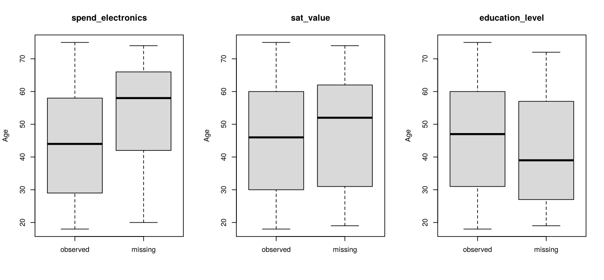{width=78%}

**Imputation.** I used `mice` with m = 20 data sets, 20 iterations and seed 2026. Methods follow each variable's type: proportional-odds model (`polr`) for the ordered education level, predictive mean matching (`pmm`) for the 1--7 rating (it only imputes values that exist) and for electronics spend (skewed, bounded at 0). All other variables, including the outcomes, serve as predictors; the identifier `customer_id` is excluded. The trace plots show well-mixed chains with no trend (convergence), and the imputed distributions are close to the observed ones; the imputed electronics values are slightly shifted to the right. Imputed education shares (29/44/27 %) match the observed ones (30/43/27 %).

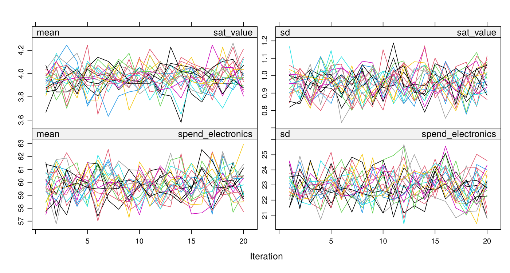{width=72%}

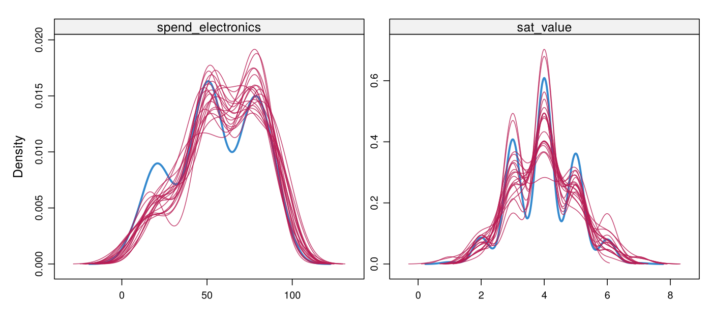{width=72%}

**Mean electronics spend.** (a) Complete cases: **EUR 55.34** (95 % CI 53.18--57.51). (b) Multiple imputation, pooled with Rubin's rules: **EUR 55.90** (95 % CI 53.87--57.94). The imputed values alone average EUR 59.8. The explanation comes from the missingness mechanism. Customers with a missing value are older and also spend a little less on groceries (EUR 40.6 vs 44.7). Age itself is not related to electronics spend (r = 0.003), but grocery spend is a near mirror of it (r = --0.89). The imputation model therefore assigns them higher electronics spend. Complete-case analysis assumes MCAR and slightly **underestimates** the mean. The bias is small here (EUR 0.56, about 1 %, well within the confidence intervals), but the complete-case estimate also wastes 70 observations. We cannot test MNAR (e.g. high spenders refusing to answer); the MI estimate is valid only under MAR.

# Task 2 -- What does "satisfaction" mean?

*Data.* PCA, factor analysis and canonical correlation are exploratory, so I use the **first completed data set** (`complete(imp, 1)`). Only `sat_value` (10 %) and `spend_electronics` (12.5 %) are imputed there, the imputations converged and look like the observed values, so a single data set changes the picture very little.

**PCA.** The correlation matrix shows two blocks: price, value and promotions correlate 0.52--0.59; staff, store and checkout correlate 0.54--0.56; correlations across blocks are below 0.16. Two components have eigenvalues above 1 (2.33 and 1.92) and explain **70.8 %** of the variance; the scree plot has a clear elbow after component 2 (eigenvalues 3--6 are all about 0.4--0.5). I keep **two components**. PC1 has loadings of the same sign on all six items (about 0.37--0.44): a general satisfaction level. PC2 contrasts the price items (+0.35 to +0.46) with the service items (--0.38 to --0.43).

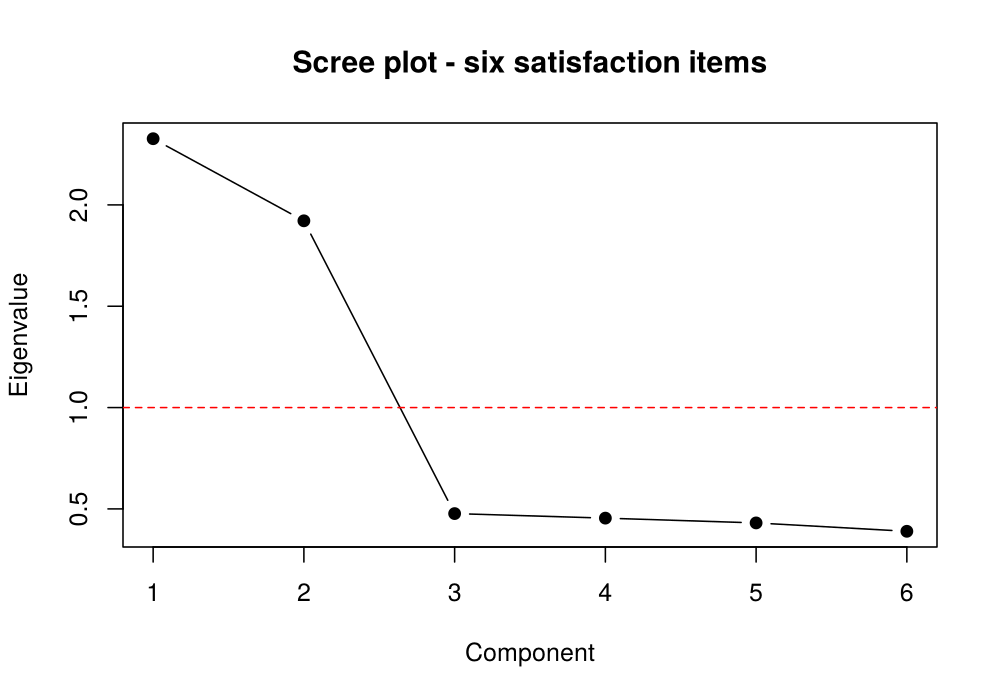{width=48%}

**Factor analysis** (`factanal`, 2 factors, varimax rotation). The likelihood-ratio test does not reject two factors ($\chi^2$ = 2.14, 4 df, p = 0.71). The rotated solution is a clean simple structure:

| Item | Factor 1 | Factor 2 |
|---|---:|---:|
| Prices are reasonable | **0.80** | -- |
| Good value for money | **0.71** | -- |
| Promotions meet my needs | **0.74** | -- |
| Staff helpful | -- | **0.76** |
| Store clean & organized | -- | **0.73** |
| Checkout quick & easy | -- | **0.74** |
| Variance explained | 28.3 % | 28.0 % |

(loadings below 0.3 hidden). Factor 1 = **"Price & Value"**, Factor 2 = **"Store Experience"**. Compared with PCA, the factor model gives the same two dimensions but in a much easier form: PCA's "general level + contrast" is a rotation of the same plane. Factor analysis explains less variance (56 % vs 71 %) because it only models the common part of the items (uniquenesses 0.36--0.48). For management the message is clear: satisfaction has **two independent dimensions**, not one.

**Scores.** I saved regression (Thomson) factor scores, `f_price` and `f_service`. To use them in Tasks 4--5 I apply the same scoring rule (loadings and correlation matrix of data set 1) to each of the 20 imputed data sets, so that the uncertainty of the imputed `sat_value` carries into the pooled models.

**Canonical correlation** (six items vs grocery, electronics and annual spend). The first canonical correlation is **0.50** (Bartlett test of all three: $\chi^2$ = 178, 18 df, p < 0.001); the second (0.17, p = 0.09) and third (0.04) are not significant. The first satisfaction variate is essentially the Price & Value factor (structure correlations 0.91 price, 0.82 promotions, 0.74 value; service items about 0). The first spending variate is essentially **annual spend** (0.98), with grocery and electronics close to 0. *Interpretation:* customers who find our prices fair and our promotions useful spend more in total over the year. They do not shift between grocery and electronics. Store experience is unrelated to spending. The correlation of 0.50 means satisfaction explains about 25 % of the variance of the spending index: a real but partial link.

# Task 3 -- Channels and customer segments

**Region $\times$ channel.** Row percentages:

| Region | Catalog | In-store | Mobile App | Online | n |
|---|---:|---:|---:|---:|---:|
| East | 19.4 | 27.3 | **32.4** | 20.9 | 139 |
| North | 21.5 | 26.6 | 21.5 | **30.4** | 158 |
| South | 22.8 | 26.2 | 24.2 | 26.8 | 149 |
| West | **36.0** | 22.8 | 23.7 | 17.5 | 114 |

The $\chi^2$ test rejects independence ($\chi^2$ = 18.35, 9 df, **p = 0.031**), but the association is weak (Cramér's V = 0.105). Standardised residuals point to three cells: West--Catalog (+3.3), East--Mobile App (+2.2), North--Online (+2.0).

**Correspondence analysis.** The first dimension explains **64.2 %** of the inertia (total inertia 0.033), the second 35.8 %. Dimension 1 opposes the **West and Catalog** (West: 77 % of the dimension's inertia, Catalog 66 %) to **North and Online**. Dimension 2 separates **East and the Mobile App** (68 % and 58 % of its inertia). In-store shopping and the South sit near the origin: they are "average". *Business reading:* catalog marketing should concentrate on the West, app campaigns on the East, online campaigns on the North; in-store is equally important everywhere.

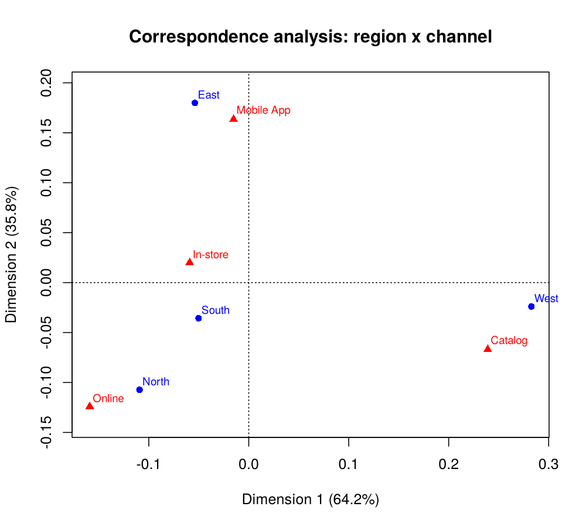{width=55%}

**Clustering.** I cluster on the two standardised spend variables of completed data set 1, so that both variables count equally. Ward's hierarchical clustering and k-means (25 random starts) were run for k = 1--8. The elbow plot drops sharply until k = 3 (within SS 1118, 355, 120, then 102) and the average silhouette is highest at **k = 3** for both methods (0.654 k-means, 0.652 Ward). The dendrogram also shows three long branches. The two methods **agree almost perfectly**: only 2 of 560 customers are classified differently (adjusted Rand index 0.989).

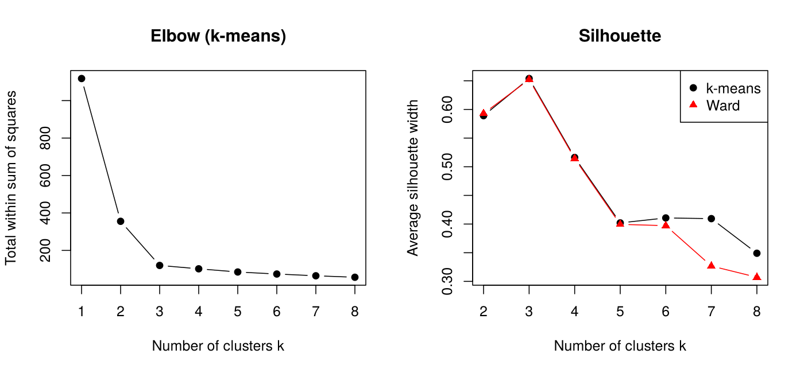{width=70%}

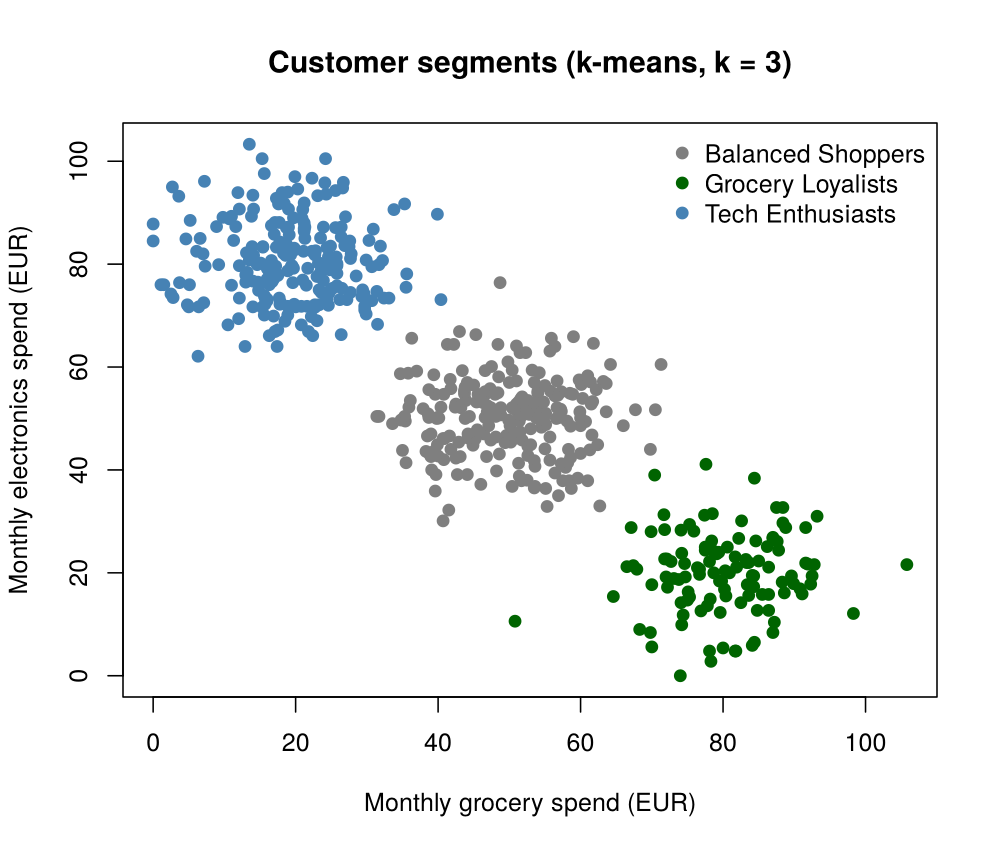{width=48%} 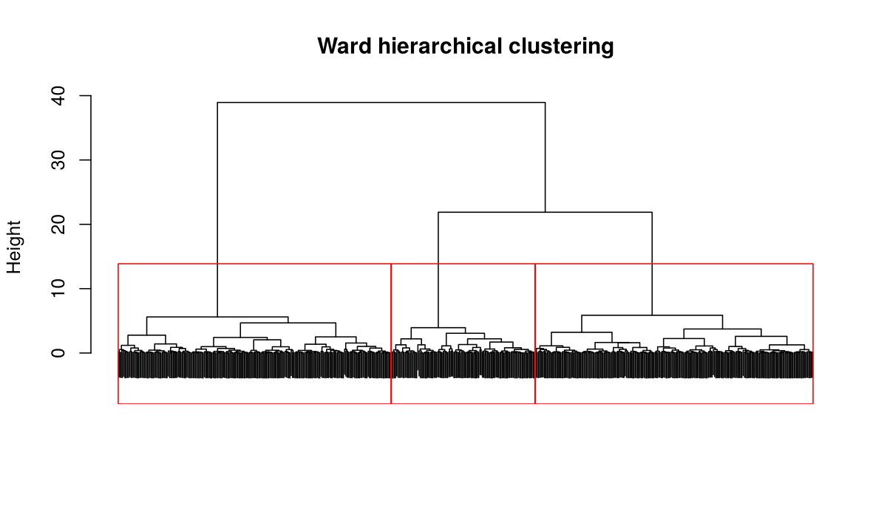{width=50%}

**Segment profiles** (k-means):

| Segment | n | Groc. | Elec. | Annual | Age | F1 | F2 | Prem. |
|--|--:|--:|--:|--:|--:|--:|--:|--:|
| Tech Enthusiasts | 219 | 19.4 | 80.4 | 663 | 45.1 | -0.06 | 0.04 | 25 % |
| Balanced Shoppers | 226 | 49.9 | 50.2 | 728 | 47.1 | 0.00 | 0.05 | 38 % |
| Grocery Loyalists | 115 | 80.3 | 20.0 | 780 | 43.4 | 0.11 | -0.17 | 50 % |

Spend in EUR (monthly for grocery/electronics, yearly for annual); F1 = Price & Value score, F2 = Store Experience score; Prem. = share upgraded. Shares of customers: 39 %, 40 %, 21 %.

The segments differ in *what* customers buy, not in age or satisfaction (factor scores within ±0.2 SD). Grocery Loyalists are the smallest group but the most valuable (highest annual spend, half are premium); Tech Enthusiasts are the largest and least valuable group, and are rarely premium. The segments are used as a predictor in Task 4.

# Task 4 -- What drives annual spend?

Age and annual spend are complete, so the age-only models are ordinary least squares on all 560 customers.

**Linear model.** annual_spend = 579 + 2.95 $\times$ age (p < 0.001, R² = 0.13): each year of age adds about EUR 3. The residual plot shows a clear **inverted-U pattern** (lowess line above zero at middle ages, below zero for the youngest and oldest): a linear effect is **not adequate**.

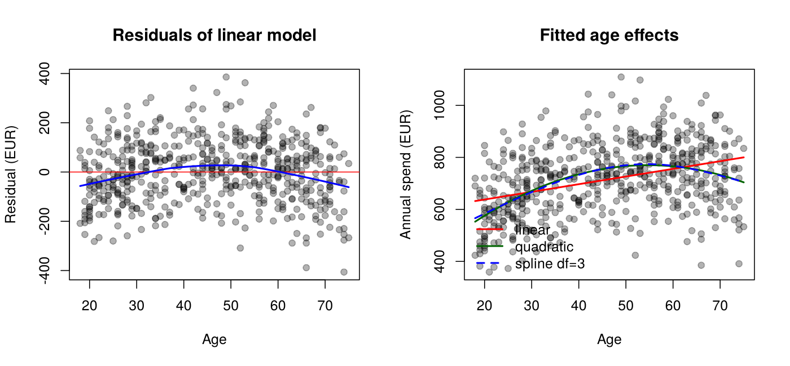{width=85%}

**Nonlinear model.** Adding a quadratic term improves the fit strongly (F = 51.8, p < 0.001; AIC 6966 vs 7013). A natural spline with 3 df gives almost the same curve and a slightly worse AIC (6968), so I keep the simpler quadratic. Predicted spend is EUR 576 at age 20, EUR 755 at 45 and EUR 733 at 70. **Spending peaks at age 54.7** (spline: 55 years, EUR 774), then declines slowly.

**Full model** (fitted on the 20 imputed data sets and pooled; quadratic age kept):

| Term | Estimate (EUR) | 95 % CI | p |
|---|---:|---:|---:|
| Price & Value score (+1 SD) | **+68.1** | 59.2 to 77.0 | < 0.001 |
| Store Experience score (+1 SD) | --1.4 | --10.3 to 7.4 | 0.75 |
| Grocery Loyalists (vs Balanced) | **+56.8** | 35.4 to 78.2 | < 0.001 |
| Tech Enthusiasts (vs Balanced) | **--56.5** | --74.1 to --38.9 | < 0.001 |
| age / age² | 17.25 / --0.158 | | < 0.001 |

Pooled R² = 0.52 (vs 0.20 with age and age² only). Pooled Wald tests confirm that both the satisfaction block (F = 113, p < 0.001) and the segment block (F = 56, p < 0.001) matter. *In euros:* a customer one standard deviation more satisfied with prices and value spends **EUR 68 more per year**, holding age and segment fixed. Store experience has **no effect** on spending. At the same age and satisfaction, a Grocery Loyalist spends EUR 57 more and a Tech Enthusiast EUR 57 less than a Balanced Shopper, a gap of EUR 113 between the two extreme segments. The age peak is unchanged (54.7 years). *Limitation:* the factor loadings and the segments come from completed data set 1; the scores are recomputed in each imputed set, but the segment labels are not, so the pooled standard errors slightly understate the uncertainty about segments.

# Task 5 -- Who upgrades to premium?

35.7 % of customers upgraded. The model uses education (dummies, reference = high school), grocery spend and the two satisfaction scores, fitted on each of the 20 imputed data sets (education is imputed) and pooled.

**Logistic regression -- odds ratios (pooled):**

| Term | OR | 95 % CI | p |
|---|---:|---:|---:|
| Bachelor (vs high school) | 1.86 | 1.10 -- 3.14 | 0.020 |
| Graduate (vs high school) | **2.81** | 1.58 -- 4.99 | < 0.001 |
| Grocery spend (+EUR 1/month) | 1.024 | 1.016 -- 1.033 | < 0.001 |
| Price & Value score (+1 SD) | 0.88 | 0.71 -- 1.11 | 0.28 |
| Store Experience score (+1 SD) | **2.99** | 2.31 -- 3.86 | < 0.001 |

*Interpretation:* holding the other variables fixed, graduates have 2.8 times the odds of upgrading of high-school customers (bachelors 1.9 times). Every extra EUR 10 of monthly grocery spend raises the odds by **27 %** (1.024^10). The strongest driver is **Store Experience**: one standard deviation more satisfaction with staff, cleanliness and checkout **triples** the odds of upgrading. Satisfaction with prices has no effect. This is the mirror image of Task 4: price satisfaction drives *how much* customers spend, while store experience drives *commitment* to the brand.

**Probit.** The probit coefficients (e.g. Store Experience 0.648, graduate 0.587, grocery 0.0144) give the same signs and significance. The logit/probit ratios are **1.62--1.76**, close to the expected 1.6. Predicted probabilities (averaged over imputations) are practically identical: correlation 0.9996, largest difference 0.015. **The choice of link does not matter** here; I report the logit because odds ratios are easier to explain.

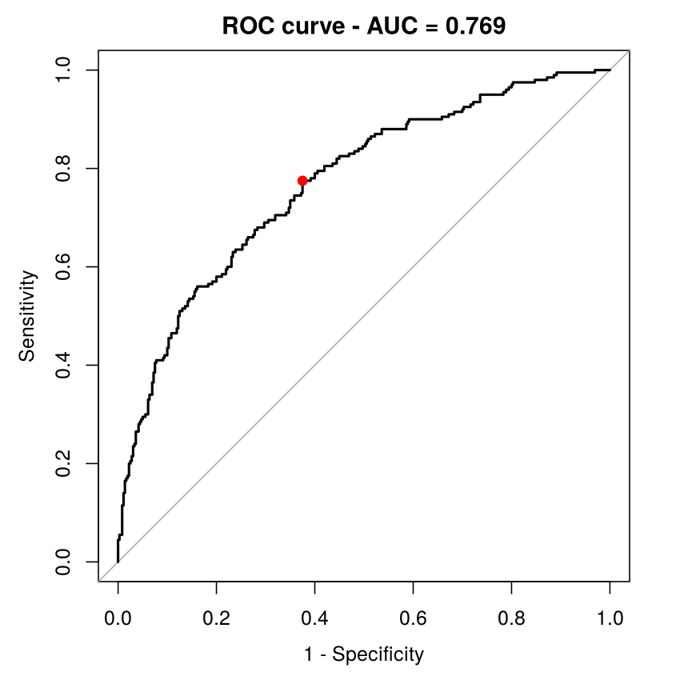{width=40%} 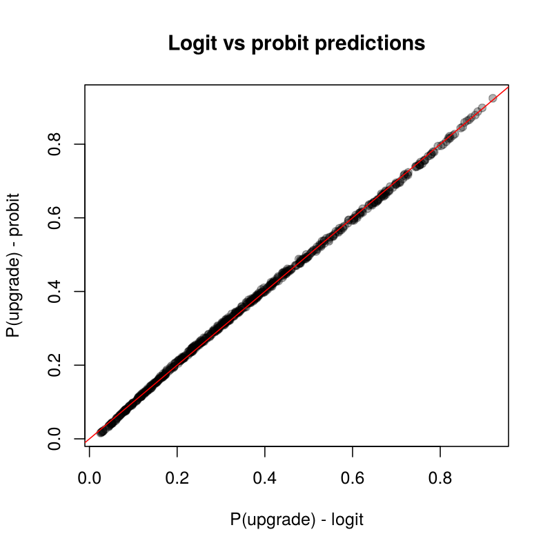{width=40%}

**Classification performance.** In-sample **AUC = 0.769** (95 % CI 0.728--0.810), identical for probit: the model ranks an upgrader above a non-upgrader 77 % of the time. The default threshold 0.5 is not appropriate here, because only 36 % upgrade: it finds less than half of the upgraders. I use the **Youden threshold 0.31**, which maximises sensitivity + specificity and is close to the base rate (0.36):

| | Actual 0 | Actual 1 |
|---|---:|---:|
| Predicted 0 | 225 | 45 |
| Predicted 1 | 135 | 155 |

Sensitivity 77.5 %, specificity 62.5 %, accuracy 67.9 %, precision 53.4 %.

At 0.5 the accuracy is higher (73.6 %) but sensitivity only 47.5 %. For a premium campaign, contacting a non-upgrader costs little while missing a likely upgrader loses revenue, so the lower threshold is the better business choice: it reaches 78 % of future upgraders by contacting about half of the customers. The AUC is computed on the training data and is therefore slightly optimistic.

# Task 6 -- Did the retention program work?

All variables used here are complete. 265 customers (47 %) were enrolled at random.

**Kaplan--Meier and log-rank.** The two curves are together for the first 2--3 months and then separate steadily. At 6 months, 77.7 % of enrolled vs 64.1 % of non-enrolled customers remain; at the end of follow-up (11.8 months), **56.4 % vs 33.5 %**. Median time to churn is 8.5 months without the program and is not reached with it. The log-rank test is highly significant ($\chi^2$ = 21.3, 1 df, **p < 0.001**).

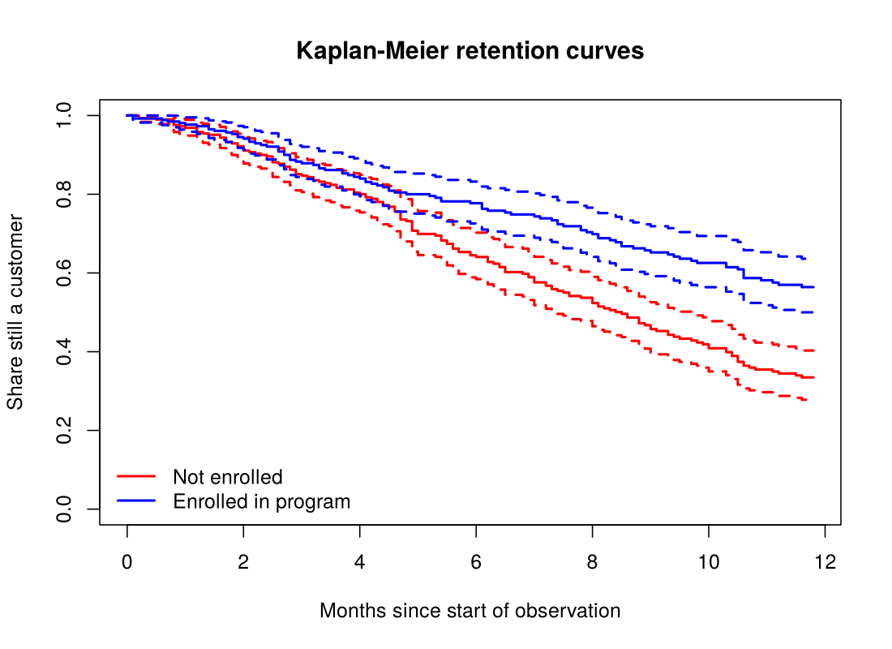{width=62%}

**Cox model** (loyalty program + age):

| | HR | 95 % CI | p |
|---|---:|---:|---:|
| Loyalty program | **0.545** | 0.422 -- 0.704 | < 0.001 |
| Age (per year) | 1.009 | 1.002 -- 1.017 | 0.019 |

*Plain language:* at any moment, **enrolled customers leave at a rate 45.5 % lower** than comparable non-enrolled customers of the same age. Each additional 10 years of age increases the churn rate by about **10 %**. Since enrolment was random, the program effect is causal, and adjusting for age changes nothing important.

**Proportional hazards.** `cox.zph` gives p = 0.15 for the program, p = 0.52 for age and p = 0.31 globally: no evidence against proportional hazards. The program effect is the same early and late in the year, so one hazard ratio summarises it well.

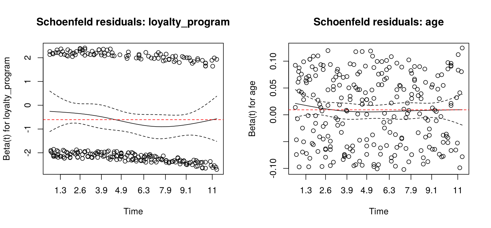{width=75%}

**Why not compare raw churn proportions?** 53.9 % of non-enrolled and 35.5 % of enrolled customers have `churn_event = 1`. This comparison ignores **censoring**. `churn_event = 0` does not mean "stayed"; it means "had not left *when we stopped watching*". Customers are followed for different lengths of time (from 0 to 11.8 months; mean 6.6 months for non-enrolled, 7.6 for enrolled). A customer censored after 1 month counts as a "stayer" exactly like one watched for 12 months. The raw proportion therefore depends on how long each group happened to be observed, and has no time scale. Kaplan--Meier and Cox use each customer only for the time they were at risk, so they give unbiased estimates when censoring is independent of churn.

**Discrete time: "left within 6 months".** Outcome = 1 if the customer left at or before month 6. **97 customers censored before month 6 are excluded**: we do not know whether they would have left before month 6 or not. Coding them 0 would assume they stayed and underestimate churn; coding them 1 would overestimate it. 463 customers remain (the excluded ones are spread evenly: 50 non-enrolled, 47 enrolled).

| Model | Program coef. | Age coef. | Program effect |
|---|---:|---:|---|
| Logit | --0.677 (p = 0.001) | 0.0133 (p = 0.034) | OR = 0.51 (0.34--0.76) |
| Probit | --0.413 (p < 0.001) | 0.0081 (p = 0.032) | ratio logit/probit = 1.64 |

At the mean age, the predicted probability of leaving within 6 months is **38.1 % without and 23.8 % with the program** (identical with logit and probit). The Kaplan--Meier values are 35.9 % and 22.3 %. They are a little lower because dropping customers censored early slightly over-represents those who left early. **Conclusion:** the discrete-time models agree with the Cox model on direction, size and significance. The program roughly halves the odds (and the hazard) of leaving, and older customers churn a little more. The Cox model remains preferable because it uses all 560 customers and the full follow-up, not just a yes/no at month 6.

\newpage

# Appendix

**A. Reproducibility.** All numbers and figures come from `analysis.R` (run from the repository root with `Rscript analysis.R`). It reads `data/project_data_Y0PV0T.csv`, writes the figures to `figures/`, and prints all results (saved in `output.txt`). Seeds: `mice` seed = 2026, k-means `set.seed(2026)`. R 4.3.3, packages mice 3.16, survival 3.5-8, cluster 2.1.6, ca 0.71.1, pROC 1.18.5.

**B. Missing-data pattern.** 384 complete rows; 60 rows miss only electronics spend, 54 only education, 47 only `sat_value`; 13 rows miss two variables and 2 rows miss all three.

**C. Missingness tests (p-values).**

| Var. | age | groc. | ann. | price | staff | gend. | reg. | chan. | loyal. |
|--|--:|--:|--:|--:|--:|--:|--:|--:|--:|
| educ. | .088 | .124 | .515 | .916 | .759 | .123 | **<.001** | .813 | .552 |
| value | .326 | .296 | .794 | .854 | .958 | .604 | .525 | .702 | .669 |
| electr. | **<.001** | .184 | .364 | .919 | .623 | .386 | .821 | .807 | .543 |

**D. Hierarchical clustering dendrogram** (Ward, red boxes = 3 clusters) is shown in Task 3; k-means within-SS for k = 1..8: 1118, 355, 120, 102, 85, 74, 65, 57.

**E. Correspondence analysis contributions (per mille).** Dimension 1: West 774, North 160, Catalog 660, Online 294. Dimension 2: East 684, North 277, Mobile App 577, Online 321.
